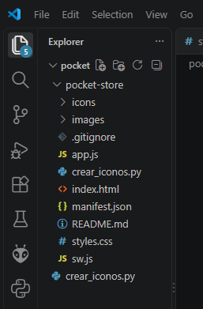
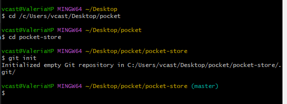
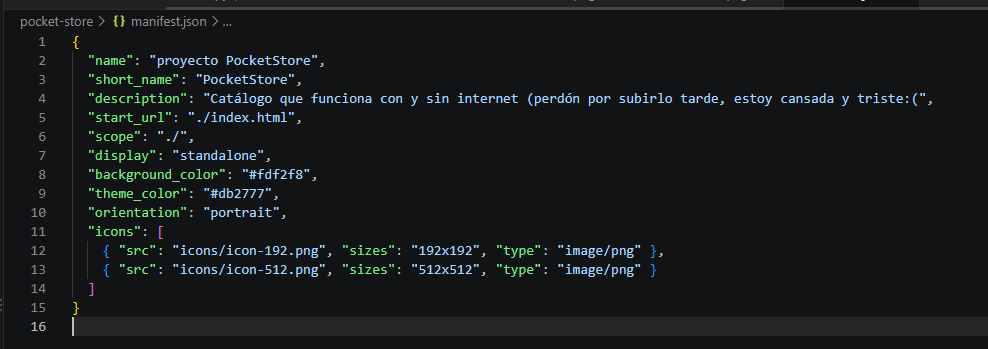
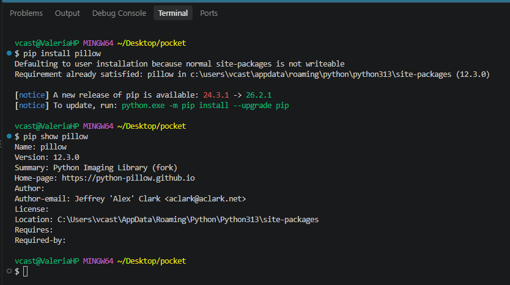
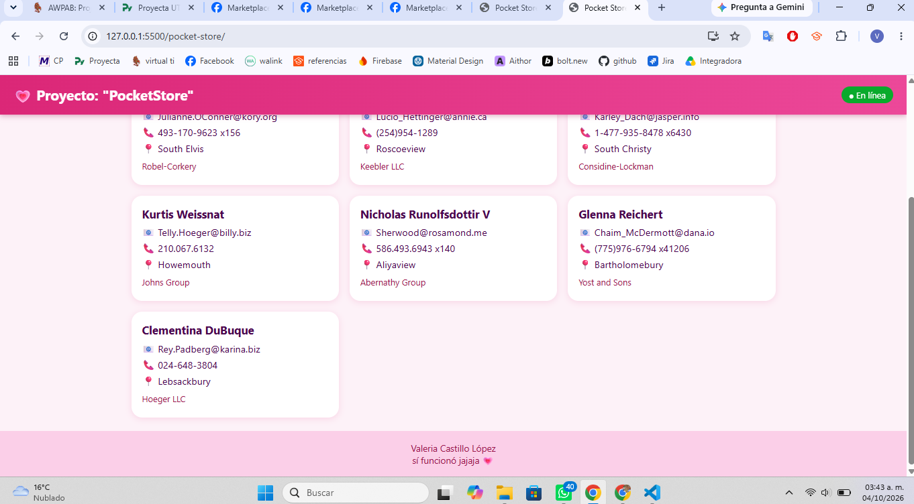
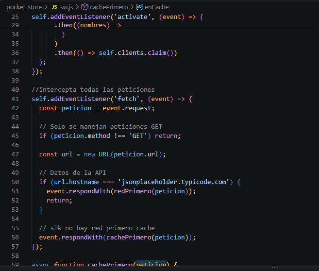
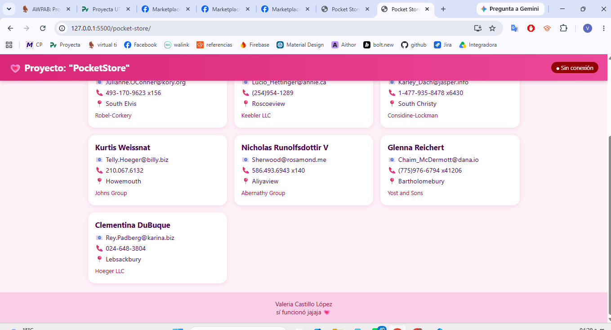

# PocketStore
Valeria Castillo López

## Estructura del proyecto
```estructura solkicitada para el proyecto en las instrucciones
/pocket-store
├── index.html         # Vista (App Shell)
├── styles.css         # Estilos del App Shell (tema rosa)
├── app.js             # Lógica de la aplicación y registro del SW
├── sw.js              # Controlador (Service Worker y caché)
├── manifest.json      # Configuración de instalación (Manifiesto)
├── crear_iconos.py    # Script que genera los iconos
├── icons/             # Iconos 192x192 y 512x512
└── images/            # Capturas del proceso de desarrollo
```


## Desarrollo
## repositorio

```bash
cd pocket-store
git init
```


## manifest.json
- Se creó el archivo JSON a mano
- Dos iconos 192x192 y 512x512 con pillow
Se usaron rutas **relativas** para que funcione igual en `localhost` y en GitHub Pages.




## index.html y styles.css
Se diseñó la estructura estática que carga al instante:

- Header con el título y un recuadro para ver si est+as En línea / Sin conexión.
- Catalogo con el contenido dinamico
- Pie de página fijo

El HTML enlaza el manifest y el CSS que usa variables una paleta rosa


## Paso 3. El Service Worker y la Caché (`sw.js`)
Se programó el ciclo de vida completo
- para los archivos propios se responde desde cache y solo se va a la red si no existe.
- para los datos de la API se intenta la red y se guarda copia en pocketstore-datos-v1 si no hay internet se devuelve la última copia guardada.



## app.js

Se consume la api `https://jsonplaceholder.typicode.com/users`
- Se muestra catalogo, crea una tarjeta por cada usuario.
- Si falla la petición, se muestra un mensaje de error.

## Pruebas
Correr el servidor con Go Live



## Subir a GitHub

```bash
git add .
git commit -m "PWA PocketStore"
git branch -M main
git remote add origin https://github.com/valeriacastillolopez/pocket-store.git
git push -u origin main
```